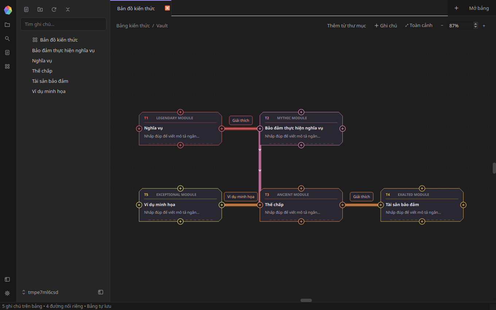
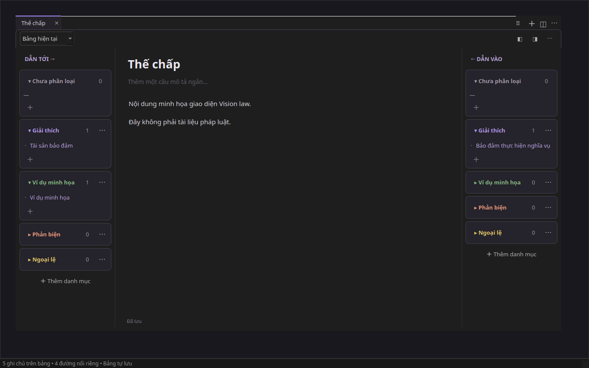

# Vision law

Ứng dụng ghi chú Markdown và tổ chức kiến thức trên bảng bo mạch, dành cho việc học và liên kết các khái niệm pháp luật.

Vision law được phát triển từ nhu cầu đọc luật trực quan: mỗi khái niệm là một thẻ, mỗi quan hệ có hướng và có thể phân loại theo **giải thích, ví dụ minh họa, phản biện, ngoại lệ** hoặc danh mục riêng.



*Ảnh minh họa bằng dữ liệu mẫu, không phải tài liệu pháp luật.*

## Tải ứng dụng

Mở [Releases](https://github.com/manhdanglsks1011012-ai/vision-law/releases) và chọn bản phát hành:

- **Portable `.tar.gz`**: giải nén và chạy `./app/vision-law`, hoặc `./install-user.sh` để thêm vào menu ứng dụng.
- **Ubuntu `.deb`**: cài qua trình quản lý gói.

Bản 1.0.0 được kiểm tra trên **Ubuntu 26.04 x86_64, glibc 2.43**. Không cần cài Python cho bản đóng gói. Windows và Linux cũ hơn chưa được xác nhận.

## Chức năng chính

- Ghi chú Markdown lưu trực tiếp trong thư mục vault; cây thư mục, tìm kiếm, đổi tên và thùng rác.
- Bảng độc lập `.vlaw`: bố trí thẻ, nối đường ống có hướng, phân loại quan hệ và đặt chú giải.
- Thẻ T1–T10 với màu sắc và phong cách vật phẩm game.
- Lược đồ ghi chú: nội dung ở giữa, quan hệ đi/đến ở hai bên.
- Cửa sổ ghi chú nội bộ có tab và chia đôi nội dung.
- Hoàn tác/làm lại trên bảng, phóng to/thu nhỏ và hỗ trợ touchpad.
- Dẫn chiếu `[[...]]` dự phòng để đọc bằng Obsidian; bố cục bảng vẫn lưu riêng.
- Phát hiện xung đột tệp, khóa vault và bản nháp phục hồi định kỳ.

Không kèm vault cá nhân hoặc cơ sở dữ liệu pháp luật. Đây là công cụ ghi chú, không cung cấp tư vấn pháp lý. Dự án độc lập, không liên kết với Obsidian.



## Tài liệu

- [Cài đặt Linux](docs/INSTALL-LINUX.md)
- [Hướng dẫn chức năng](docs/USER-GUIDE.md)
- [Kiểm tra và giới hạn bản 1.0](docs/RELEASE-VALIDATION-1.0.md)
- [Kết quả kiểm thử](docs/TEST-RESULTS.txt)
- [Giấy phép thư viện](THIRD_PARTY.md)

## Chạy từ mã nguồn

Môi trường đã kiểm tra: Python 3.14.4, PyQt6/Qt 6.10.2 trên Ubuntu 26.04.

```bash
git clone https://github.com/manhdanglsks1011012-ai/vision-law.git
cd vision-law
python3 -m venv .venv
. .venv/bin/activate
python3 -m pip install -r requirements.txt
python3 launch.py
```

Mở vault cụ thể: `python3 launch.py /duong/dan/vault`.

```bash
QT_QPA_PLATFORM=offscreen python3 -m unittest discover -v
```

Đóng gói Linux: cài `requirements-build.txt` trong môi trường build, cùng `dpkg-deb`, sau đó chạy `./packaging/build-linux.sh`. Xem script để biết yêu cầu thư viện/giấy phép theo môi trường Ubuntu đã dùng.

## Báo lỗi

Tạo Issue với phiên bản ứng dụng, hệ điều hành, thao tác tái hiện và kết quả mong đợi. Chỉ đính kèm dữ liệu mẫu; bỏ thông tin riêng tư khỏi log và ảnh chụp. Sao lưu vault trước khi thử nghiệm.

## Giấy phép

Copyright (C) 2026 Vision law contributors.

Vision law phát hành theo **GNU General Public License phiên bản 3 (GPL-3.0-only)**. Xem [LICENSE](LICENSE). Không có bảo đảm; xem điều khoản giấy phép. Thư viện bên thứ ba giữ giấy phép và bản quyền riêng.
